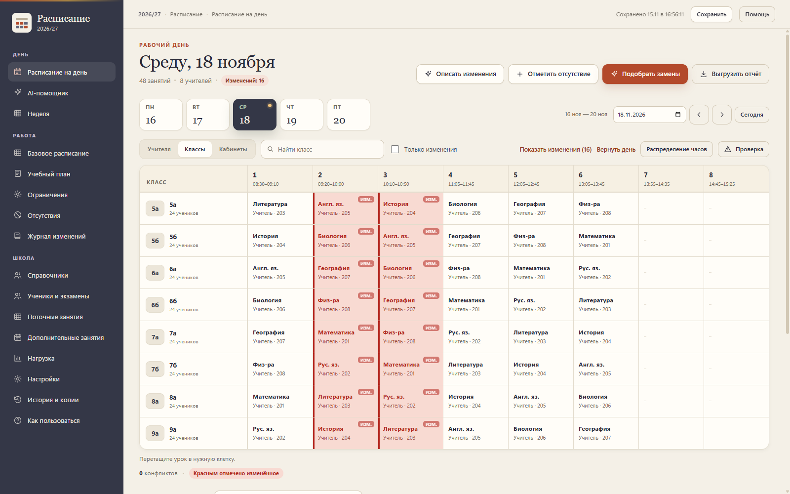

# Расписание

### Планируйте неделю. Меняйте день.

Приложение для завуча: учебный план, школьное расписание, 
ежедневные перестановки и готовые отчёты — в одном окне.

**[Скачать для Windows](https://github.com/denisp222/school-schedule/releases/latest/download/ScheduleSetup.exe)**
&nbsp; · &nbsp;
[Что нового](CHANGELOG.md)
&nbsp; · &nbsp;
[Сообщить об ошибке](https://github.com/denisp222/school-schedule/issues)

 

Настоящий интерфейс приложения. На скриншоте — специально созданный демонстрационный проект без школьных данных.

## От годового плана до завтрашних замен

Проект появился из простой задачи: помочь маме-завучу перестать исправлять распечатки карандашом. Составить базовую неделю, учесть отсутствие учителя, сравнить перестановки и выдать понятную таблицу — без повторного переноса всего вручную.

**Расписание хранится на вашем компьютере.** Для составления, редактирования и выгрузки отчётов интернет не нужен. AI-помощник подключается отдельно; пользоваться приложением можно и без него.

## Возможности

В **2.25.0** добавлены четыре чередующиеся недели и индивидуальные занятия:
занятость преподавателей и помещений, карточки учеников, изменения на дату
и общие Word-отчёты.

| | Что можно делать |
| :--- | :--- |
| **Учебный план и базовая неделя** | Назначать нагрузку, составлять неделю автоматически или вручную. Готовить изменения в отдельном черновике и вводить новую редакцию с выбранной даты. |
| **Изменения на день** | Отмечать отсутствия, сравнивать варианты перестановок и смотреть результат до сохранения. Изменённые занятия выделяются красным. |
| **Редактор расписания** | Работать с общими таблицами по классам, учителям и кабинетам. Перетаскивать занятия, открывать ячейки двойным щелчком, отменять и повторять правки. |
| **Условия школы** | Задавать доступность учителей и кабинетов, парные уроки, подгруппы, потоки, совместные занятия и согласованные исключения. Учитывать классные часы и дополнительную занятость. |
| **AI-помощник** | Описывать просьбы обычными словами, получать справку, проверять нагрузку и готовить изменения настроек с подтверждением. Сохранять отдельные диалоги; использовать необязательный голосовой ввод. |
| **Отчёты** | Выгружать расписание в Word, в том числе по своим шаблонам, с отметками изменений или без них. Экспортировать план, нагрузку и журнал в CSV. |
| **Ученики и экзамены** | Вести списки, импортировать CSV, отмечать выбранные предметы и формировать ведомости Word/CSV. |
| **История и перенос** | Возвращаться к сохранённым версиям и переносить проект полной резервной копией. Импортировать готовое расписание из Хронографа. |
| **Четыре недели и индивидуальные занятия** | Повторять календарный цикл, вести отдельные карточки, учитывать индивидуальные уроки и началку в занятости преподавателей, кабинетов и отчётах. |

### Как подбираются перестановки

Расчёт выполняется локальным алгоритмом с проверкой ограничений, а не свободным ответом языковой модели.

- В первую очередь ищутся варианты **без окон у учеников и подгрупп**.
- Учитываются сохранение часов, нежелательные поздние уроки у 5–6 классов и количество перестановок. Окна учителей не запрещены.
- Парные занятия сохраняются вместе. Дневные изменения не переносят уроки на другие даты.
- Если вариант без окон не найден, показываются резервные варианты с явным предупреждением и отдельным подтверждением.

Подробнее о переносе функций: [сопоставление с Хронографом](docs/CHRONOGRAPH-PARITY.md).

## Быстрый старт

1. **[Скачайте установщик](https://github.com/denisp222/school-schedule/releases/latest/download/ScheduleSetup.exe)** для Windows 10/11, 64-разрядной версии.
2. Установите приложение и откройте ярлык **«Расписание»**. Python и инструменты разработки устанавливать не нужно.
3. Заполните справочники и учебный план либо загрузите свою резервную копию в разделе **«История и копии»**.
4. Подготовьте базовую неделю. Для ежедневных правок откройте **«Расписание на день»** или **«AI-помощник»**.

> Публичная установка создаёт **пустой проект**. Школьная база, реальные фамилии, личные шаблоны и ключи API в установщик не входят.

**Обновление поверх старой версии.** Удалять приложение не нужно. Оно проверяет выпуски в фоне и предлагает обновиться в своём окне; установка и перезапуск требуют подтверждения. База хранится отдельно от программы. В автозагрузку Windows приложение не добавляется.

<strong>Переход с Хронографа 3.0 Мастер</strong>

В разделе **«История и копии → Импорт Хронографа»** выберите файл `.chngf`/`.hgf` либо четыре штатных HTML-отчёта. Сначала приложение покажет состав проекта и результаты проверки. Замена текущего проекта выполняется только после подтверждения.

Для чтения закрытого формата `.chngf` нужна установленная оригинальная программа: импорт использует её временную копию. Исходный файл не меняется. Для импорта HTML-отчётов и для дальнейшей повседневной работы Хронограф не требуется.

После переноса проверьте учебный период, звонки и назначения. Перед заменой существующего проекта сохраните полную резервную копию.

## AI-помощник

**Справка и сводки работают локально.** Для разбора сложных просьб подключите в настройках свой ключ DeepSeek API или OpenRouter. Оплата внешнего сервиса отделена от приложения; можно задать предел расходов.

Например:

> «Учителя 01 завтра не будет. Подбери перестановки без окон, сохрани парные уроки».
>
> «Покажи нагрузку учителя 02».
>
> «Как подготовить новое постоянное расписание, сохранив действующее?»

Помощник объясняет условия и предлагает результат. **Изменения сохраняются после вашего подтверждения.** Обращение к внешней модели передаёт текст просьбы и необходимый контекст; состав передаваемых данных описан в [PRIVACY.md](PRIVACY.md).

## Ваши данные

| Что | Где хранится |
| :--- | :--- |
| База, настройки, история и личные шаблоны | `%LOCALAPPDATA%\SchoolSchedule\Data` |
| Готовые отчёты | По умолчанию — в документах пользователя; папку можно выбрать при сохранении |
| Полная резервная копия | В выбранном вами файле; для переноса подключения AI используется копия с паролем |
| Исходники и обновления | В GitHub, отдельно от школьной базы |

Расписание не синхронизируется с GitHub. Проверка обновлений не отправляет школьные данные; телеметрии нет. Состав копий, защита ключей и особенности внешнего AI: **[данные и публикация](PRIVACY.md)**.

## Для разработчиков

**Python 3.13 · FastAPI · SQLite · OR-Tools CP-SAT · JavaScript · WebView2 / WinForms**

Это настольное приложение с локальным веб-интерфейсом. FastAPI обслуживает его только на этом компьютере; отдельный сервер школы не нужен. SQLite хранит проект, OR-Tools рассчитывает расписание, WebView2 отображает интерфейс в обычном окне Windows.

| Документ | Содержание |
| :--- | :--- |
| [Разработка и сборка](docs/DEVELOPMENT.md) | Локальный запуск, тесты, структура проекта и публичный установщик |
| [Автоматические обновления](docs/AUTO-UPDATES.md) | GitHub Actions, выпуски и проверка подписанного описания обновления |
| [Детерминированный подбор](docs/DETERMINISTIC-REPAIR.md) | Воспроизводимость расчёта и проверка результата |
| [Сопоставление с Хронографом](docs/CHRONOGRAPH-PARITY.md) | Перенесённые рабочие сценарии и условия импорта |
| [История изменений](CHANGELOG.md) | Изменения по версиям |

## Обратная связь

Нашли ошибку или не хватает рабочего сценария? [Создайте issue](https://github.com/denisp222/school-schedule/issues/new): укажите версию, последовательность действий и ожидаемый результат.

**Используйте вымышленные примеры.** Не прикладывайте школьную базу, резервные копии, ключи API или снимки с реальными персональными данными. Для изменений кода можно открыть pull request; проверки исходников и тесты запускаются в GitHub Actions.
